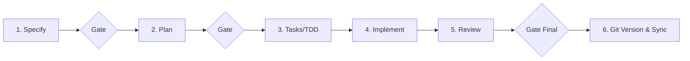

# AGENTS.md — Diretrizes e Orquestração Multi-Agente SDD ASVS

Este repositório implementa uma ferramenta de autoavaliação baseada no **OWASP ASVS 5.0 (Capítulo V1, Nível 1)**.
O ciclo de engenharia do projeto segue rigorosamente o modelo **Spec-Driven Development (SDD)**, orquestrado pelo condutor principal e suportado por 11 agentes especialistas.

---

## 1. Stack Tecnológica Nuclear

- **Linguagem & Framework**: Python 3.12, FastAPI (assíncrono, streaming via Server-Sent Events - SSE).
- **Persistência & Contratos**: SQLModel, Pydantic v2, SQLite (`asvs.db`). Todo estado reside no banco, nunca mantido em memória solta ou contexto conversacional.
- **Análise Estática (SAST)**: Semgrep CLI invocado de forma segura (`shell=False`, argumentos em lista).
- **Análise Dinâmica (DAST)**: OWASP ZAP via Docker Daemon + API REST (estritamente passivo/baseline sem consentimento prévio e validação de allowlist).
- **Avaliação de IA**: `AIEvaluatorAgent` utilizando credenciais write-only isoladas em memória (`AISecretStore`), saídas estritamente estruturadas via Pydantic e proteção contra injeção de prompt.
- **Interface & Acessibilidade**: HTML5 + Web Components do Microsoft Fluent 2 Design System, suporte a tema claro e escuro, conformidade WCAG 2.2 AA.

---

## 2. Guardrails Inegociáveis (Princípio IV da Constituição)

Todos os agentes com permissão de escrita DEVEM respeitar os seguintes guardrails ao introduzir ou alterar código:

1. **Execução de Comandos**: NUNCA utilizar `shell=True` ou concatenação de strings em `subprocess`. Sempre passar comandos como `list[str]`.
2. **Confinamento de Arquivos**: Operações de leitura/escrita devem validar se o caminho resolvido está estritamente contido no workspace do projeto.
3. **Guardrails DAST / ZAP**: Nenhuma requisição ou varredura ZAP pode ser executada sem validação prévia de `zap_authorized=True` e verificação da URL na allowlist explícita.
4. **Isolamento de Credenciais (Zero-Leakage)**: Tokens e chaves de API NUNCA devem ser logados, expostos em endpoints REST, armazenados no banco SQLite (`asvs.db`) ou inseridos em relatórios.
5. **Truncamento de Ferramentas**: Saídas de SAST/DAST entregues aos agentes de runtime devem ser paginadas ou truncadas em no máximo 50 achados. Nunca despejar relatórios brutos no contexto.

---

## 3. Fluxo de Execução Multi-Agente SDD

O ciclo de desenvolvimento de novas features ou manutenções deve ser conduzido pela seguinte esteira:



### Agente Condutor (`sdd-conductor`)
É o agente ativo na sessão principal. Ele dispara os comandos do spec-kit em `.gemini/commands/` e invoca os especialistas:

1. **Fase 1: Specify & Clarify**
   - Dispara `/speckit.specify` e `/speckit.clarify`.
   - Consulta `asvs-mapper` para mapear requisitos normativos ASVS 5.0 para ferramentas.
   - *Se a feature alterar superfície de ataque (ACI/ZAP/IA)*: invoca `threat-modeler`.
   - Invoca `constitution-guardian` para validação formal pré-gate.

2. **Fase 2: Plan**
   - Dispara `/speckit.plan`.
   - Invoca `solution-architect` para validar design de dados, contratos Pydantic e conformidade assíncrona.
   - Invoca `constitution-guardian` para validação pré-gate.

3. **Fase 3: Tasks & TDD**
   - Dispara `/speckit.tasks`.
   - Invoca `test-author` para gerar casos de teste em `tests/` baseados nos cenários Given/When/Then da spec antes da codificação.

4. **Fase 4: Implementação**
   - Dispara `/speckit.implement`.
   - Delega tarefas de backend para `backend-implementer` (`app/`).
   - Delega tarefas de UI/Fluent para `frontend-implementer` (`templates/`, `static/`).
   - *Se envolver novas regras SAST*: aciona `sast-rules-engineer`.
   - *Se envolver integração DAST*: aciona `dast-zap-engineer`.

5. **Fase 5: Revisão e Encerramento**
   - Executa em paralelo `aci-security-reviewer` e `llm-security-reviewer`.
   - Executa `constitution-guardian` para conferência final dos requisitos "DEVE".
   - Apresenta resumo de conformidade para aprovação humana final.

6. **Fase 6: Versionamento Git & Sync GitHub**
   - Valida que `.gitignore` está ativo e protegendo segredos, banco SQLite (`asvs.db`) e diretórios de execução.
   - Executa `git add .` com os artefatos de spec, código e testes validados.
   - Cria commit semântico padronizado (ex.: `feat(spec-XXX): <resumo da entrega>`).
   - Executa `git push origin main` para persistir o marco de versão no repositório remoto GitHub (`oaksan/asvs`).

---

## 4. Comandos de Verificação do Projeto

- **Executar Testes Unitários e de Integração**:
  ```bash
  .venv/bin/pytest -q
  ```
- **Executar Teste Específico com Log Completo**:
  ```bash
  .venv/bin/pytest -vv tests/test_ai_gate.py
  ```
- **Subir Container do OWASP ZAP (Background)**:
  ```bash
  docker compose up -d zap
  ```

