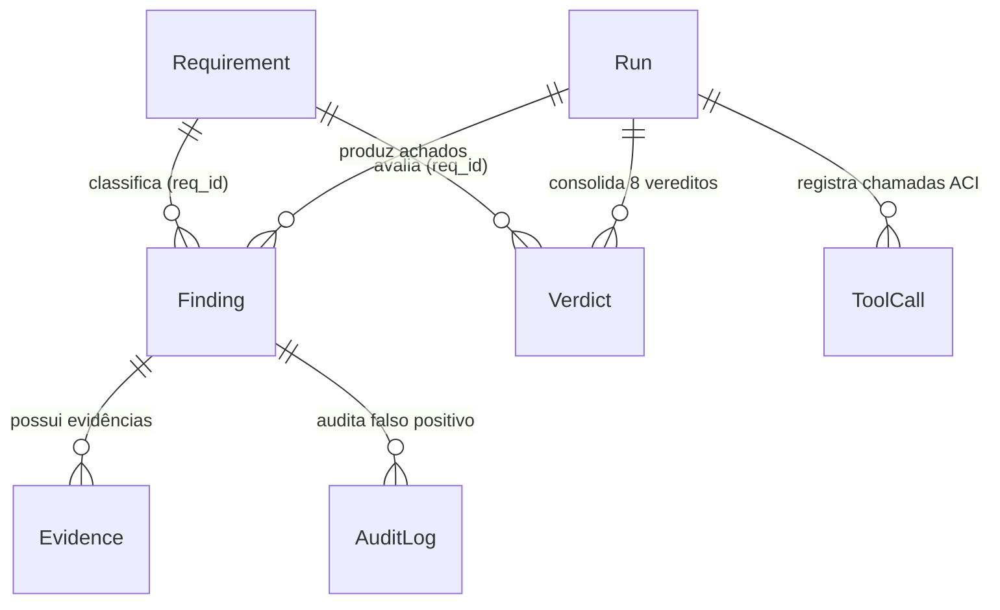
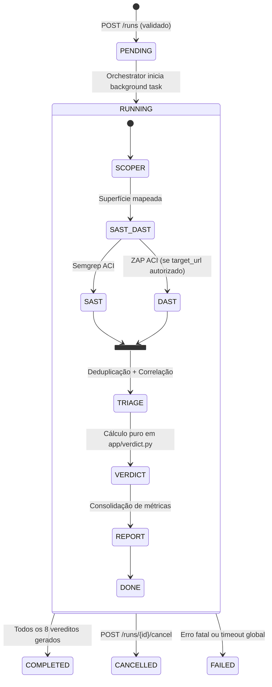

# Phase 1 Data Model: ASVS-Self-Assesment-Tool (`app/models.py` & `asvs.db`)

**Feature**: `001-asvs-v1-assessment`  
**Date**: 2026-10-12  
**Persistence Engine**: SQLite (`asvs.db`) via SQLModel + Pydantic v2

---

## 1. Visão Geral das Entidades (`app/models.py`)

O esquema relacional em SQLite persiste integralmente o catálogo normativo do OWASP ASVS 5.0, o estado de cada execução do pipeline (`Run`), a telemetria de chamadas da ACI (`ToolCall`), os achados deduplicados (`Finding`), as evidências detalhadas (`Evidence`), os vereditos consolidados (`Verdict`) e a trilha de auditoria de falsos positivos (`AuditLog`).

---

## 2. Definição Detalhada dos Modelos

### 2.1 `Requirement` (Catálogo Normativo ASVS 5.0)

Armazena os 345 requisitos semeados a partir de `docs/OWASP_Application_Security_Verification_Standard_5_0_0_en.csv` (alias local `docs/OWASP_Application_Security_Verification_Standard_5.0.0_en.csv`).

| Campo | Tipo (SQLModel / Python) | Restrições / Índices | Descrição |
| :--- | :--- | :--- | :--- |
| `req_id` | `str` | `primary_key=True`, `index=True` | Identificador único do requisito (ex.: `"V1.2.1"`). |
| `chapter_id` | `str` | `index=True`, `nullable=False` | Identificador do capítulo (`"V1"` a `"V17"`). |
| `chapter_name` | `str` | `nullable=False` | Nome do capítulo (ex.: `"Encoding and Sanitization"`). |
| `section_id` | `str` | `index=True`, `nullable=False` | Identificador da seção (ex.: `"V1.2"`, `"V1.3"`, `"V1.5"`). |
| `section_name` | `str` | `nullable=False` | Nome da seção (ex.: `"Injection Prevention"`). |
| `req_description` | `str` | `nullable=False` | Texto normativo completo do requisito no ASVS 5.0. |
| `level` | `int` | `index=True`, `nullable=False` | Nível ASVS (`1`, `2` ou `3`), mapeado da coluna `L` do CSV. |
| `in_scope` | `bool` | `index=True`, `default=False` | `True` exclusivamente quando `chapter_id == 'V1' and level == 1` (8 requisitos). |

**Regras de Validação**:
- Na carga inicial (*seed*), a contagem total DEVE ser `345` e a contagem com `in_scope == True` DEVE ser exatamente `8` (`V1.2.1`, `V1.2.2`, `V1.2.3`, `V1.2.4`, `V1.2.5`, `V1.3.1`, `V1.3.2`, `V1.5.1`).

---

### 2.2 `Run` (Execução do Pipeline de Avaliação)

Representa uma execução completa ou em andamento do pipeline de avaliação sobre um código-fonte e/ou URL alvo.

| Campo | Tipo (SQLModel / Python) | Restrições / Índices | Descrição |
| :--- | :--- | :--- | :--- |
| `id` | `int | None` | `primary_key=True` | Identificador sequencial da execução. |
| `source_type` | `str` | `nullable=False` | Origem do código: `"workspace_path"` ou `"zip_upload"`. |
| `source_path` | `str` | `nullable=False` | Caminho resolvido e confinado ao workspace onde o código reside. |
| `target_url` | `str | None` | `nullable=True` | URL alvo da aplicação para o OWASP ZAP (opcional se execução apenas SAST). |
| `zap_authorized` | `bool` | `default=False` | Confirmação explícita (checkbox) de autorização para DAST. |
| `zap_mode` | `str` | `default="baseline"` | Modo de operação ZAP: `"baseline"` (passivo, default) ou `"active"`. |
| `status` | `str` | `index=True`, `default="PENDING"` | Estado: `"PENDING"`, `"RUNNING"`, `"COMPLETED"`, `"FAILED"`, `"CANCELLED"`. |
| `current_stage` | `str` | `default="INIT"` | Etapa atual: `"INIT"`, `"SCOPER"`, `"SAST"`, `"DAST"`, `"TRIAGE"`, `"VERDICT"`, `"REPORT"`, `"DONE"`. |
| `pass_percentage` | `float` | `default=0.0` | Percentual de requisitos `PASS` sobre os 8 em escopo (`0.0` a `100.0`). |
| `pass_count` | `int` | `default=0` | Total de requisitos com veredito `PASS`. |
| `fail_count` | `int` | `default=0` | Total de requisitos com veredito `FAIL`. |
| `inconclusive_count` | `int` | `default=0` | Total de requisitos com veredito `INCONCLUSIVE`. |
| `manual_count` | `int` | `default=0` | Total de requisitos com veredito `MANUAL_REQUIRED`. |
| `scope_summary_json` | `str` | `default="{}"` | Resumo JSON gerado pelo `Scoper` (linguagens, arquivos por superfície, rotas). |
| `error_message` | `str | None` | `nullable=True` | Mensagem de erro ou motivo de cancelamento/timeout, se aplicável. |
| `created_at` | `datetime` | `default_factory=utcnow` | Data/hora de criação da execução (UTC). |
| `finished_at` | `datetime | None` | `nullable=True` | Data/hora de término da execução (UTC). |

**Regras de Validação**:
- Se `target_url` for preenchido, `zap_authorized` DEVE ser `True` e o host/porta de `target_url` DEVE constar na `allowlist`.
- `source_path` DEVE resolver dentro do diretório permitido do workspace (`Path.resolve().is_relative_to(WORKSPACE_ROOT)`).

---

### 2.3 `ToolCall` (Observabilidade e Auditoria da Camada ACI)

Registra cada invocação realizada pelos agentes às interfaces `semgrep_aci`, `zap_aci` e `workspace_aci`.

| Campo | Tipo (SQLModel / Python) | Restrições / Índices | Descrição |
| :--- | :--- | :--- | :--- |
| `id` | `int | None` | `primary_key=True` | Identificador da chamada ACI. |
| `run_id` | `int` | `foreign_key="run.id"`, `index=True` | Execução à qual a chamada pertence. |
| `agent_name` | `str` | `index=True`, `nullable=False` | Nome do agente invocador (`"Scoper"`, `"SASTAgent"`, `"DASTAgent"`, etc.). |
| `aci_name` | `str` | `nullable=False` | Módulo ACI (`"workspace_aci"`, `"semgrep_aci"`, `"zap_aci"`). |
| `command` | `str` | `nullable=False` | Nome do comando executado (ex.: `"run_rules"`, `"zap_scan"`). |
| `args_json` | `str` | `nullable=False` | Argumentos sanitizados em JSON (sem segredos). |
| `status` | `str` | `nullable=False` | `"SUCCESS"`, `"BLOCKED_GUARDRAIL"`, `"TIMEOUT"`, `"ERROR"`. |
| `duration_ms` | `int` | `nullable=False` | Tempo de execução da chamada em milissegundos. |
| `output_summary` | `str` | `nullable=False` | Resumo informativo retornado ao agente (ex.: `"0 achados para a regra X em 12 arquivos"`). |
| `created_at` | `datetime` | `default_factory=utcnow` | Carimbo de tempo da chamada. |

---

### 2.4 `Finding` (Achado de Segurança Deduplicado)

Representa um alerta estático (Semgrep) ou dinâmico (OWASP ZAP) normalizado, deduplicado e associado a um `req_id` de `V1 L1`.

| Campo | Tipo (SQLModel / Python) | Restrições / Índices | Descrição |
| :--- | :--- | :--- | :--- |
| `id` | `int | None` | `primary_key=True` | Identificador único do achado. |
| `run_id` | `int` | `foreign_key="run.id"`, `index=True` | Execução de origem. |
| `req_id` | `str` | `foreign_key="requirement.req_id"`, `index=True` | Requisito ASVS afetado (`"V1.2.1"` a `"V1.5.1"`). |
| `tool` | `str` | `index=True`, `nullable=False` | Ferramenta geradora: `"semgrep"` ou `"zap"`. |
| `rule_or_plugin_id` | `str` | `nullable=False` | ID da regra Semgrep ou plugin ZAP. |
| `title` | `str` | `nullable=False` | Título curto descritivo do achado. |
| `severity` | `str` | `nullable=False` | Severidade normalizada: `"HIGH"`, `"MEDIUM"`, `"LOW"`, `"INFO"`. |
| `confidence` | `str` | `nullable=False` | Nível de confiança: `"HIGH"`, `"MEDIUM"`, `"LOW"`. |
| `fingerprint` | `str` | `index=True`, `nullable=False` | Hash determinístico (`req_id + tool + rule_id + location`) para deduplicação. |
| `primary_location` | `str` | `nullable=False` | `arquivo:linha` (SAST) ou `MÉTODO URL` (DAST). |
| `is_false_positive` | `bool` | `index=True`, `default=False` | Indica se foi marcado manualmente como falso positivo na triagem. |
| `fp_reason` | `str | None` | `nullable=True` | Justificativa atual do falso positivo (sincronizada com `AuditLog`). |
| `created_at` | `datetime` | `default_factory=utcnow` | Data/hora de registro. |

---

### 2.5 `Evidence` (Evidência Concreta Navegável)

Armazena o detalhe probatório vinculado a um `Finding` (ou evidência positiva de superfície verificada).

| Campo | Tipo (SQLModel / Python) | Restrições / Índices | Descrição |
| :--- | :--- | :--- | :--- |
| `id` | `int | None` | `primary_key=True` | Identificador da evidência. |
| `finding_id` | `int` | `foreign_key="finding.id"`, `index=True` | Achado ao qual a evidência pertence. |
| `evidence_type` | `str` | `nullable=False` | `"code_snippet"` (SAST) ou `"http_exchange"` (DAST). |
| `file_path` | `str | None` | `nullable=True` | Caminho relativo do arquivo dentro do projeto avaliado (SAST). |
| `line_start` | `int | None` | `nullable=True` | Linha inicial do trecho de código (SAST). |
| `line_end` | `int | None` | `nullable=True` | Linha final do trecho de código (SAST). |
| `code_snippet` | `str | None` | `nullable=True` | Trecho de código extraído (truncado com segurança na ACI). |
| `http_method` | `str | None` | `nullable=True` | Método HTTP (`GET`, `POST`, etc.) quando DAST. |
| `http_url` | `str | None` | `nullable=True` | URL/endpoint completo testado quando DAST. |
| `http_request` | `str | None` | `nullable=True` | Cabeçalhos e payload da requisição HTTP (DAST). |
| `http_response` | `str | None` | `nullable=True` | Cabeçalhos e trecho relevante da resposta HTTP (DAST). |

---

### 2.6 `Verdict` (Veredito Consolidado por Requisito em Escopo)

Armazena a decisão final para cada um dos 8 requisitos de `V1 L1` em uma determinada `Run`.

| Campo | Tipo (SQLModel / Python) | Restrições / Índices | Descrição |
| :--- | :--- | :--- | :--- |
| `id` | `int | None` | `primary_key=True` | Identificador do veredito. |
| `run_id` | `int` | `foreign_key="run.id"`, `index=True` | Execução avaliada. |
| `req_id` | `str` | `foreign_key="requirement.req_id"`, `index=True` | Requisito em escopo (`"V1.2.1"` a `"V1.5.1"`). |
| `status` | `str` | `index=True`, `nullable=False` | Enum normativo: `"PASS"`, `"FAIL"`, `"INCONCLUSIVE"`, `"MANUAL_REQUIRED"`. |
| `confidence_level` | `str` | `nullable=False` | `"HIGH"`, `"MEDIUM"`, `"LOW"`. |
| `tools_used_json` | `str` | `nullable=False` | Lista JSON das ferramentas executadas (ex.: `["semgrep", "zap"]`). |
| `rules_executed_json` | `str` | `nullable=False` | Lista JSON de IDs de regras Semgrep e plugins ZAP executados. |
| `coverage_declared` | `str` | `nullable=False` | Declaração explícita de cobertura (ex.: `"14 arquivos Python e 6 rotas HTTP verificadas"`). |
| `positive_evidence_json` | `str` | `nullable=False` | Evidências positivas que sustentam `PASS` (regras limpas + superfície existente). |
| `active_findings_count` | `int` | `default=0` | Quantidade de achados ativos (não falsos positivos) para o requisito. |
| `rationale` | `str` | `nullable=False` | Justificativa técnica detalhada do veredito. |
| `limitations` | `str` | `nullable=False` | Limitações conhecidas (ex.: `"DAST executado apenas em modo passivo baseline"`). |
| `updated_at` | `datetime` | `default_factory=utcnow` | Última atualização (inicial ou após triagem de falso positivo). |

**Regras de Invariância (`app/verdict.py`)**:
1. Se `active_findings_count > 0` → `status` DEVE ser `"FAIL"`.
2. Se `req_id == "V1.3.1"` e houver superfície de entrada HTML rica sem comprovação conclusiva de sanitizador seguro (ou quando a regra exigir inspeção humana de contexto WYSIWYG) → `status` DEVE ser `"MANUAL_REQUIRED"`.
3. Para `status == "PASS"`: `active_findings_count == 0` **E** `len(rules_executed) >= 1` **E** superfície relevante > 0 (`positive_evidence` presente) **E** cobertura suficiente declarada.
4. Caso contrário (zero achados, porém sem superfície relevante mapeada, ferramenta não executada ou cobertura insuficiente) → `status` DEVE ser `"INCONCLUSIVE"`.

---

### 2.7 `AuditLog` (Trilha de Auditoria de Triagem / Falsos Positivos)

Registra de forma imutável toda marcação ou desmarcação manual de falso positivo realizada pelo usuário.

| Campo | Tipo (SQLModel / Python) | Restrições / Índices | Descrição |
| :--- | :--- | :--- | :--- |
| `id` | `int | None` | `primary_key=True` | Identificador do evento de auditoria. |
| `run_id` | `int` | `foreign_key="run.id"`, `index=True` | Execução associada. |
| `finding_id` | `int` | `foreign_key="finding.id"`, `index=True` | Achado modificado. |
| `req_id` | `str` | `index=True`, `nullable=False` | Requisito afetado pela triagem. |
| `action` | `str` | `nullable=False` | `"MARK_FP"` ou `"UNMARK_FP"`. |
| `previous_value` | `bool` | `nullable=False` | Valor anterior de `is_false_positive`. |
| `new_value` | `bool` | `nullable=False` | Novo valor de `is_false_positive`. |
| `justification` | `str` | `nullable=False` | Justificativa textual obrigatória informada pelo avaliador (mín. 5 caracteres). |
| `actor` | `str` | `default="local_evaluator"` | Identificador do avaliador na sessão. |
| `created_at` | `datetime` | `default_factory=utcnow` | Data/hora exata do registro (UTC). |

---

## 3. Transições de Estado

### 3.1 Ciclo de Vida de `Run.status` e `Run.current_stage`

