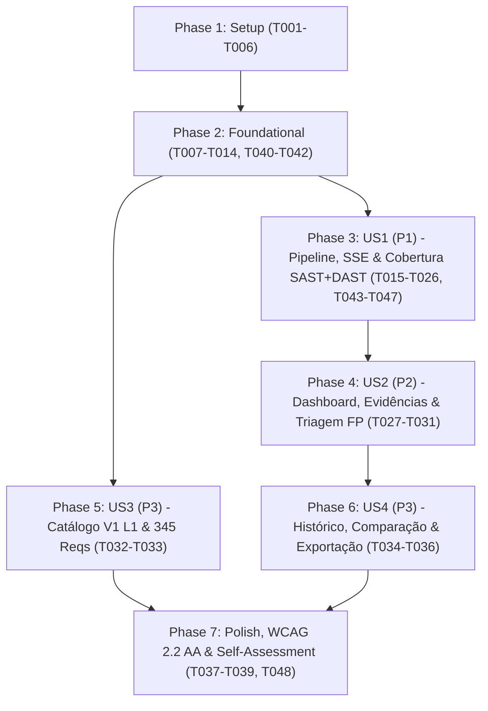

# Tasks: Pipeline e Dashboard Web de Autoavaliação OWASP ASVS 5.0 (Capítulo V1 - Level 1)

**Input**: Design documents from `/specs/001-asvs-v1-assessment/`  
**Prerequisites**: [plan.md](./plan.md) (required), [spec.md](./spec.md) (required for user stories), [research.md](./research.md), [data-model.md](./data-model.md), [contracts/](./contracts/)  
**Tests**: Incluídos conforme exigido na especificação (`FR-015` e requisitos não funcionais: testes unitários para veredito, ACI, parsers SARIF/ZAP e fixture `tests/vulnerable_app/` para integração).  
**Organization**: Tarefas agrupadas por jornada de usuário (*User Story*) para permitir implementação, teste e validação independentes de cada incremento.

## Format: `[ID] [P?] [Story] Description`

- **[P]**: Pode ser executada em paralelo (arquivos distintos, sem dependências de tarefas incompletas)
- **[Story]**: Rótulo da User Story correspondente (`[US1]`, `[US2]`, `[US3]`, `[US4]`) — exclusivo para as fases de User Stories
- Todas as descrições incluem o caminho exato do arquivo alvo

---

## Phase 1: Setup (Shared Infrastructure)

**Purpose**: Inicialização da estrutura de diretórios, manifesto de dependências, containers Docker, tokens Fluent 2 e artefatos normativos declarativos.

- [X] T001 Create project directory structure (`app/`, `app/aci/`, `app/agents/`, `config/semgrep_rules/`, `templates/`, `static/`, `tests/vulnerable_app/`) and package initializers in `app/__init__.py`, `app/aci/__init__.py`, and `app/agents/__init__.py`
- [X] T002 Create Python 3.12 dependencies manifest (`fastapi`, `uvicorn`, `sqlmodel`, `pydantic`, `pandas`, `httpx`, `python-owasp-zap-v2.4`, `sse-starlette`, `jinja2`, `pyyaml`, `python-multipart`, `semgrep`, `pytest`, `pytest-asyncio`) in `requirements.txt`
- [X] T003 [P] Create containerization files for the FastAPI application and the OWASP ZAP daemon service (`zap.sh -daemon -host 0.0.0.0 -port 8080`) in `Dockerfile` and `docker-compose.yml`
- [X] T004 [P] Consult the `microsoft/fluentui` skill (`https://www.skills.sh/`, `token-lookup` and `v9-component`) and create the Fluent 2 Design System token stylesheet supporting light/dark themes (`webLightTheme` / `webDarkTheme`), WCAG 2.2 AA contrast ratios, and print-to-PDF layout in `static/theme.css`
- [X] T005 [P] Create the explicit OWASP ASVS 4.0 Testing Guide → ASVS 5.0 equivalence table for the 8 `V1 L1` requirements (`V1.2.1`, `V1.2.2`, `V1.2.3`, `V1.2.4`, `V1.2.5`, `V1.3.1`, `V1.3.2`, `V1.5.1`) marking each row strictly as `"confirmada"` or `"a validar"` in `docs/mapping_4_0_to_5_0.md`
- [X] T006 [P] Create the versioned declarative mapping linking each of the 8 `V1 L1` `req_id`s to Semgrep rule IDs, passive/active OWASP ZAP plugin IDs, expected code surfaces, and positive evidence criteria in `config/req_tool_mapping.yaml`

---

## Phase 2: Foundational (Blocking Prerequisites)

**Purpose**: Modelos de dados SQLModel/Pydantic, banco SQLite com seed automático dos 345 requisitos, regras Semgrep customizadas, camada ACI com guardrails e motor puro de veredito.

**⚠️ CRITICAL**: Nenhuma User Story pode ser iniciada antes da conclusão desta fase.

- [X] T007 Implement all SQLModel and Pydantic entities in `app/models.py` enforcing the exact constraints from `data-model.md`: `Requirement` (`req_id` `primary_key=True`, `chapter_id`, `section_id`, `level: int`, `in_scope: bool` `default=False`), `Run` (`source_type` `"workspace_path"|"zip_upload"`, `source_path` non-null, `target_url` nullable, `zap_authorized: bool` `default=False`, `zap_mode` `default="baseline"`, `status` `"PENDING"|"RUNNING"|"COMPLETED"|"FAILED"|"CANCELLED"`, `current_stage` `default="INIT"`, `pass_percentage: float` `0.0`–`100.0`), `ToolCall` (`run_id` FK, `agent_name`, `aci_name`, `command`, `status` `"SUCCESS"|"BLOCKED_GUARDRAIL"|"TIMEOUT"|"ERROR"`, `duration_ms: int`, `output_summary` non-empty), `Finding` (`run_id` FK, `req_id` FK, `tool` `"semgrep"|"zap"`, `severity` `"HIGH"|"MEDIUM"|"LOW"|"INFO"`, `confidence` `"HIGH"|"MEDIUM"|"LOW"`, `fingerprint` indexed, `is_false_positive: bool` `default=False`), `Evidence` (`finding_id` FK, `evidence_type` `"code_snippet"|"http_exchange"`), `Verdict` (`run_id` FK, `req_id` FK, `status` `"PASS"|"FAIL"|"INCONCLUSIVE"|"MANUAL_REQUIRED"`, `confidence_level` `"HIGH"|"MEDIUM"|"LOW"`, `coverage_declared` non-null, `active_findings_count: int` `default=0`), and `AuditLog` (`run_id` FK, `finding_id` FK, `action` `"MARK_FP"|"UNMARK_FP"`, `justification` required min 5 chars)
- [X] T008 Implement SQLite engine (`asvs.db`), session dependency provider, automatic schema initialization, and idempotent startup CSV seed loader reading `docs/OWASP_Application_Security_Verification_Standard_5.0.0_en.csv` (with fallback alias `docs/OWASP_Application_Security_Verification_Standard_5_0_0_en.csv`), verifying `345` total rows (`V1`–`V17`) and computing `in_scope = (chapter_id == 'V1' and level == 1)` for exactly `8` rows in `app/database.py`
- [X] T009 [P] Create custom Semgrep rules covering `V1.2.1` (HTML/HTTP/XML output encoding, `autoescape=False`, `|safe`, `innerHTML`), `V1.2.2` (dynamic URLs, `javascript:`/`data:` schemes, open redirect), `V1.2.3` (unescaped JS/JSON in `<script>`), `V1.2.4` (non-parameterized SQL/NoSQL string formatting), `V1.2.5` (OS command injection, `shell=True`, `os.system`), `V1.3.1` (unsanitized rich/WYSIWYG HTML input), `V1.3.2` (`eval()`, `exec()`, dynamic code execution), and `V1.5.1` (XML parsers with external entities enabled / XXE) in `config/semgrep_rules/v1_2_injection.yaml`, `config/semgrep_rules/v1_3_sanitization.yaml`, and `config/semgrep_rules/v1_5_deserialization.yaml`
- [X] T010 [P] Implement the generic `ACIResponse[T]` contract (`MAX_PAGE_SIZE = 50`, non-empty `summary_message` invariant, `ToolCall` persistence helper, and sliding-window observation history collapser `K = 5`) plus workspace commands (`scan_workspace_surface`, `list_files`, `read_snippet`, and safe `.zip` extraction rejecting `..` and external symlinks with `Path.resolve().is_relative_to(WORKSPACE_ROOT)`) in `app/aci/workspace_aci.py`
- [X] T011 [P] Implement the Semgrep ACI (`run_rules`, `list_findings`, `show_evidence`) executing the Semgrep CLI strictly via argument lists (`shell=False`), parsing SARIF 2.1.0 outputs, truncating code snippets to 20 lines, paginating findings at 50 items per page, and returning explicit feedback when zero findings occur (`"0 achados para a regra X em N arquivos"`) in `app/aci/semgrep_aci.py`
- [X] T012 [P] Implement the OWASP ZAP ACI (`zap_spider`, `zap_scan`, `zap_alerts`) communicating via `httpx` with the ZAP daemon REST API, enforcing `zap_authorized == True` and `target_url` allowlist guardrails prior to execution, defaulting to passive `"baseline"` scan, restricting `"active"` scan to mapped `V1 L1` plugin IDs, truncating HTTP request/response bodies to 2,048 characters, and paginating alerts at 50 items per page in `app/aci/zap_aci.py`
- [X] T013 [P] Implement the pure, side-effect-free verdict and coverage calculation module (`evaluate_requirement_verdict` and `compute_run_metrics`) enforcing the Positive Evidence Rule (`PASS` requires `active_findings_count == 0`, at least 1 executed rule/plugin, verified surface > 0, and declared coverage; `INCONCLUSIVE` when coverage/surface is insufficient; `MANUAL_REQUIRED` for `V1.3.1` when automated sanitization evidence is inconclusive; `FAIL` when `active_findings_count > 0`) in `app/verdict.py`
- [X] T014 Configure shared `pytest` and `pytest-asyncio` fixtures (isolated test SQLite database seeded with all 345 requirements, sample workspace paths, and mocked ACI/ZAP adapters) in `tests/conftest.py`
- [X] T040 [P] Update `RequirementVerdictInput` (adding `required_tools: list[str] = ["semgrep"]`) and `evaluate_requirement_verdict` to return `VerdictStatus.INCONCLUSIVE` whenever `"zap" in required_tools` and `not has_dast_positive` (with 0 active findings) in `app/verdict.py`
- [X] T041 [P] Refine `scan_workspace_surface` to ignore scanner/ACI metadata files (`app/aci/`, `config/`, `tests/`) when matching positive sanitization indicators (`bleach.clean`, `DOMPurify`, `nh3.clean`) for `V1.3.1` in `app/aci/workspace_aci.py`
- [X] T042 [P] Update `zap_spider` and `zap_scan` to verify real OWASP ZAP daemon connectivity (`/JSON/core/view/version/`), return `executed_plugins_by_req = {}` when the daemon is offline, and filter `"baseline"` mode to execute only passive plugins (returning `[]` for active-only requirements `V1.2.4`, `V1.2.5`, `V1.5.1`) in `app/aci/zap_aci.py`

**Checkpoint**: Infraestrutura de banco, seeds, regras Semgrep, camada ACI e função pura de veredito prontas e desbloqueadas para as User Stories.

---

## Phase 3: User Story 1 - Executar Avaliação Automatizada do ASVS V1 L1 com Acompanhamento em Tempo Real (Priority: P1) 🎯 MVP

**Goal**: Permitir que o avaliador configure e inicie uma avaliação do escopo ASVS V1 L1 (via upload `.zip` ou caminho local no workspace + URL alvo autorizada para o ZAP), acompanhe as etapas em tempo real via SSE (`Scoper` → `SAST` / `DAST` → `Triage/Correlação` → `Veredito` → `Relatório`), cancele ou reexecute de forma idempotente e obtenha os 8 vereditos fundamentados.

**Independent Test**: Submeter `tests/vulnerable_app/` e `app/` em `POST /api/runs`, consumir `GET /api/runs/{id}/events` até a conclusão e verificar que o fixture vulnerável produz `FAIL` com evidências localizadas, execuções "Somente SAST" em `app/` marcam os 6 requisitos dependentes de ZAP como `INCONCLUSIVE`, `V1.3.1` como `MANUAL_REQUIRED` e `V1.3.2` como `PASS`, e alvos sem autorização são bloqueados pelos guardrails.

### Tests for User Story 1 ⚠️

- [X] T015 [P] [US1] Create the deliberately vulnerable target application fixture containing planted vulnerabilities for all 8 `V1 L1` requirements (`V1.2.1` reflected XSS/`|safe`, `V1.2.2` open redirect/`javascript:` URL, `V1.2.3` unescaped inline JSON in `<script>`, `V1.2.4` SQL injection via f-string, `V1.2.5` OS command injection with `shell=True`, `V1.3.1` unsanitized WYSIWYG HTML input, `V1.3.2` dynamic `eval()`, and `V1.5.1` XML parser with `resolve_entities=True`) in `tests/vulnerable_app/app.py`
- [X] T016 [P] [US1] Write unit tests for `evaluate_requirement_verdict` and `compute_run_metrics` covering `PASS` (with positive evidence), `FAIL`, `INCONCLUSIVE` (zero findings without surface/coverage), and `MANUAL_REQUIRED` (`V1.3.1`) in `tests/test_verdict.py`
- [X] T017 [P] [US1] Write unit tests for `workspace_aci`, `semgrep_aci`, and `zap_aci` verifying path confinement, `.zip` traversal rejection, `shell=False` invocation, ZAP authorization/allowlist blocking, 50-item pagination, and explicit zero-finding messages in `tests/test_aci.py`
- [X] T018 [P] [US1] Write end-to-end pipeline integration tests executing the orchestrator against `tests/vulnerable_app/`, testing SSE stage transitions, run cancellation (`POST /api/runs/{id}/cancel`), and idempotent rerun (`POST /api/runs/{id}/rerun`) in `tests/test_pipeline_integration.py`
- [X] T043 [P] [US1] Update unit tests to verify that requirements mapped to `required_tools=["semgrep", "zap"]` (`V1.2.1`–`V1.2.5`, `V1.5.1`) return `INCONCLUSIVE` on SAST-only runs or passive-only runs for active-plugin requirements, while `V1.3.2` (`required_tools=["semgrep"]`) returns `PASS` in `tests/test_verdict.py`
- [X] T044 [P] [US1] Update end-to-end integration tests to verify that a SAST-only self-assessment on `app` produces `0 FAIL`, `PASS` for `V1.3.2`, `MANUAL_REQUIRED`/`INCONCLUSIVE` for `V1.3.1`, and `INCONCLUSIVE` for the 6 ZAP-dependent requirements (`V1.2.1`–`V1.2.5`, `V1.5.1`) in `tests/test_pipeline_integration.py`

### Implementation for User Story 1

- [X] T019 [P] [US1] Implement the `Scoper` agent (`ScoperInput` / `ScoperOutput` Pydantic contracts) using `workspace_aci.scan_workspace_surface` to map languages, files, and applicable code surfaces per `req_id` (`V1.2.1`–`V1.5.1`) in `app/agents/scoper.py`
- [X] T020 [P] [US1] Implement the `SAST Agent` (`SASTAgentInput` / `SASTAgentOutput` Pydantic contracts) invoking `semgrep_aci.run_rules` and `semgrep_aci.list_findings` for each of the 8 `V1 L1` requirements while collapsing observations older than `K = 5` steps in `app/agents/sast_agent.py`
- [X] T021 [P] [US1] Implement the `DAST Agent` (`DASTAgentInput` / `DASTAgentOutput` Pydantic contracts) invoking `zap_aci.zap_spider`, `zap_aci.zap_scan`, and `zap_aci.zap_alerts` with passive `"baseline"` default mode and observation history collapsing in `app/agents/dast_agent.py`
- [X] T022 [P] [US1] Implement the `Verdict Agent` (`VerdictAgentInput` / `VerdictAgentOutput` Pydantic contracts) calling `app/verdict.py` for each of the 8 in-scope requirements and persisting `Verdict` records in `app/agents/verdict_agent.py`
- [X] T023 [US1] Implement the `Triage/Correlation Agent` (`TriageAgentInput` / `TriageAgentOutput` Pydantic contracts) deduplicating raw findings by `fingerprint` (`req_id + tool + rule_id + location`) and correlating matching SAST and DAST findings to elevate confidence in `app/agents/triage_agent.py`
- [X] T024 [US1] Implement the `Orchestrator` agent (`OrchestratorInput` / `OrchestratorOutput` Pydantic contracts) managing the `Run` state machine (`SCOPER` → parallel `SAST` & `DAST` via `asyncio.gather` → `TRIAGE` → `VERDICT` → `REPORT` → `DONE`), per-stage timeouts, cancellation tokens, and real-time SSE event queue publishing in `app/agents/orchestrator.py`
- [X] T025 [US1] Implement FastAPI dependency injection (`Depends` for DB session, config, and orchestrator runner), the root HTML route (`GET /` with Jinja2 `autoescape=True`), and the run execution endpoints (`POST /api/runs`, `GET /api/runs/{run_id}`, `GET /api/runs/{run_id}/events` via `EventSourceResponse`, `POST /api/runs/{run_id}/cancel`, and `POST /api/runs/{run_id}/rerun`) in `app/main.py`
- [X] T026 [US1] Build the Fluent 2 "Nova Avaliação" form (code source selector for `.zip` upload or workspace path, target URL input, mandatory DAST authorization checkbox, and passive baseline vs. active ZAP mode selector) and the real-time SSE pipeline progress stepper with Cancel and Rerun buttons in `templates/index.html` and `static/app.js`
- [X] T045 [P] [US1] Update `VerdictAgent.run` and `recalculate_single_requirement_verdict` to inject `required_tools = mapping.get(req_id, {}).get("tools", ["semgrep"])` from `config/req_tool_mapping.yaml` into `RequirementVerdictInput` in `app/agents/verdict_agent.py`
- [X] T046 [P] [US1] Update `DASTAgent.run` to propagate OWASP ZAP daemon connectivity status and mode-filtered `executed_plugins_by_req` without forging plugin execution when the daemon is offline in `app/agents/dast_agent.py`
- [X] T047 [US1] Update the `#self-check-btn` handler to preserve or auto-fill `#target-url` (`window.location.origin` / `http://localhost:8000`) when `#zap-authorized` is checked and display an informative warning when running in SAST-only mode in `static/app.js` and `templates/index.html`

**Checkpoint**: User Story 1 (MVP + Iteração 2) completa, funcional e testável de forma independente ponta a ponta.

---

## Phase 4: User Story 2 - Analisar Dashboard de Conformidade, Inspecionar Evidências e Realizar Triagem de Falsos Positivos (Priority: P2)

**Goal**: Apresentar o dashboard Fluent 2 com cartões de métricas (`% PASS`, `PASS`, `FAIL`, `INCONCLUSIVE`, `MANUAL_REQUIRED`), gráficos leves em SVG (donut de vereditos e barras por seção `V1.2`, `V1.3`, `V1.5`), tabela filtrável dos 8 requisitos, inspeção navegável de evidências (`arquivo:linha` e `request/response`) e marcação manual de falsos positivos com justificativa obrigatória em `AuditLog` e recálculo imediato do veredito.

**Independent Test**: Carregar uma execução concluída no dashboard, filtrar a tabela dos 8 requisitos, abrir o painel de evidências de um achado e marcá-lo como falso positivo via `PATCH /api/findings/{id}/triage` verificando o registro em `AuditLog` e a atualização imediata do veredito e do `% PASS`.

### Tests for User Story 2 ⚠️

- [X] T027 [P] [US2] Write unit and API tests for SARIF/ZAP evidence extraction, fingerprint deduplication, and false-positive triage (`PATCH /api/findings/{id}/triage` rejecting empty/short justifications `< 5` chars, creating `AuditLog` entries, and recalculating `Verdict` and `Run.pass_percentage`) in `tests/test_parsers_and_triage.py`

### Implementation for User Story 2

- [X] T028 [P] [US2] Implement the `Reporter Agent` (`ReporterAgentInput` / `ReporterAgentOutput` Pydantic contracts) aggregating run metrics (`% PASS` over 8, counts per verdict) and section-level breakdowns (`V1.2`, `V1.3`, `V1.5`) in `app/agents/reporter_agent.py`
- [X] T029 [US2] Implement findings and triage REST endpoints (`GET /api/runs/{run_id}/findings` with `req_id`/`severity`/`tool`/`include_fp` filters and 50-item pagination, `GET /api/findings/{finding_id}/evidence`, and `PATCH /api/findings/{finding_id}/triage` persisting `AuditLog` and recalculating the requirement `Verdict` and `Run` metrics) in `app/main.py`
- [X] T030 [US2] Build the responsive Fluent 2 Dashboard summary cards (`% PASS`, `PASS`, `FAIL`, `INCONCLUSIVE`, `MANUAL_REQUIRED`), native SVG charts styled with Fluent design tokens (verdict distribution donut chart and `V1.2`/`V1.3`/`V1.5` section bar chart), and the filterable 8-requirement verdict table in `templates/index.html` and `static/app.js`
- [X] T031 [US2] Build the navigable Evidence Drawer (displaying `arquivo:linha` code snippets and HTTP `request/response` exchanges with safe DOM `textContent` rendering) and the False Positive Triage dialog with mandatory justification validation and audit trail viewer in `templates/index.html` and `static/app.js`

**Checkpoint**: User Stories 1 e 2 completas e verificáveis independentemente.

---

## Phase 5: User Story 3 - Consultar Catálogo ASVS 5.0 (Escopo V1 L1 e Catálogo Completo V1–V17) e Equivalências 4.0 → 5.0 (Priority: P3)

**Goal**: Permitir listar detalhadamente os 8 requisitos em escopo (`V1 L1`) com seção, descrição, ferramentas/regras mapeadas e status de equivalência `4.0 → 5.0` (`"confirmada"` ou `"a validar"`), além de consultar em modo somente leitura os 345 requisitos do catálogo completo (`V1`–`V17`).

**Independent Test**: Consultar `GET /api/requirements/in-scope` (8 itens) e `GET /api/requirements` (345 itens) e validar na aba "Catálogo ASVS 5.0" a alternância entre a visão de escopo ativo e a busca somente leitura de todos os capítulos e níveis.

### Implementation for User Story 3

- [X] T032 [P] [US3] Implement catalog endpoints `GET /api/requirements/in-scope` (returning the 8 `V1 L1` requirements enriched with `config/req_tool_mapping.yaml` rules/plugins and `docs/mapping_4_0_to_5_0.md` equivalence status) and `GET /api/requirements` (read-only paginated query over all 345 `V1`–`V17` requirements filterable by `chapter_id`, `level`, `in_scope`, and search query) in `app/main.py`
- [X] T033 [US3] Build the "Catálogo ASVS 5.0" view in the UI with a toggle between "Escopo Ativo V1 L1 (8 Requisitos)" (showing section, normative description, Semgrep/ZAP mappings, and `"confirmada"`/`"a validar"` 4.0 equivalence badges) and "Catálogo Completo V1–V17 (345 Requisitos - Somente Leitura)" with search and chapter/level filters in `templates/index.html` and `static/app.js`

**Checkpoint**: User Stories 1, 2 e 3 funcionais de forma independente.

---

## Phase 6: User Story 4 - Comparar Histórico de Execuções e Exportar Relatórios (Priority: P3)

**Goal**: Permitir consultar o histórico de execuções, comparar lado a lado duas avaliações (`base_run_id` vs. `target_run_id`) destacando a evolução dos 8 requisitos e exportar o relatório completo em JSON e HTML estático autossuficiente (com suporte a impressão PDF).

**Independent Test**: Selecionar duas execuções no histórico para visualizar o painel comparativo (`GET /api/runs/compare`) e exportar o relatório consolidado em JSON e HTML estático (`GET /api/runs/{id}/export?format=json|html`).

### Implementation for User Story 4

- [X] T034 [P] [US4] Extend `Reporter Agent` with report serialization methods generating structured JSON reports and self-contained static HTML reports (embedding Fluent 2 styles, SVG charts, 8 requirement verdicts, evidences, limitations, and `AuditLog` entries with print-ready PDF styles) in `app/agents/reporter_agent.py`
- [X] T035 [US4] Implement run history listing (`GET /api/runs`), two-run comparison (`GET /api/runs/compare?base_run_id=X&target_run_id=Y` computing `% PASS` delta, verdict count deltas, and per-requirement transitions across all 8 `V1 L1` requirements), and report download (`GET /api/runs/{run_id}/export?format=json|html`) in `app/main.py`
- [X] T036 [US4] Build the "Histórico & Comparação" UI panel (run history list, dual-run selector, side-by-side diff table for the 8 requirements highlighting regressions/improvements) and export action buttons (`Exportar JSON`, `Exportar HTML Estático`, `Imprimir / Salvar PDF`) in `templates/index.html` and `static/app.js`

**Checkpoint**: Todas as 4 User Stories implementadas e testáveis de maneira independente.

---

## Phase 7: Polish & Cross-Cutting Concerns

**Purpose**: Refinamento de acessibilidade WCAG 2.2 AA, alternância de tema claro/escuro, autoavaliação de segurança da própria ferramenta (conformidade V1 L1) e validação final do `quickstart.md`.

- [X] T037 [P] Audit and refine WCAG 2.2 AA accessibility across all views (keyboard tab order, visible `:focus-visible` outlines, `aria-live="polite"` announcements for SSE pipeline stages, accessible `<title>`/`<desc>` in SVG charts, and persistent `webLightTheme`/`webDarkTheme` switcher) in `templates/index.html`, `static/app.js`, and `static/theme.css`
- [X] T038 [P] Execute a self-assessment run targeting the tool's own source code (`app/`, `templates/`, `static/`) to verify `0 FAIL` across all 8 ASVS `V1 L1` requirements and update validation notes in `docs/mapping_4_0_to_5_0.md`
- [X] T039 Run the complete automated test suite (`pytest -v`) and verify all end-to-end validation steps in `specs/001-asvs-v1-assessment/quickstart.md`
- [X] T048 Update the self-assessment verification section for Iteration 2 (documenting SAST-only `12.5% PASS` / `6 INCONCLUSIVE` / `1 MANUAL_REQUIRED` vs. SAST+DAST execution) and re-verify the complete test suite (`pytest -v`) in `docs/mapping_4_0_to_5_0.md`

---

## Dependencies & Execution Order

### Phase Dependencies

- **Phase 1: Setup (`T001`–`T006`)**: Sem dependências — concluída na Iteração 1.
- **Phase 2: Foundational (`T007`–`T014`, `T040`–`T042`)**: Depende da Fase 1 — **BLOQUEIA** a validação final das User Stories na Iteração 2.
- **Phase 3: User Story 1 - P1 (`T015`–`T026`, `T043`–`T047`)**: Depende da conclusão da Fase 2 (`T040`–`T042`). Atualiza o motor de veredito, agentes `VerdictAgent`/`DASTAgent`, UI de autoavaliação e testes de precisão SAST vs. DAST.
- **Phase 4: User Story 2 - P2 (`T027`–`T031`)**: Concluída na Iteração 1; beneficia-se automaticamente de `recalculate_single_requirement_verdict` atualizado em `T045`.
- **Phase 5: User Story 3 - P3 (`T032`–`T033`)**: Concluída na Iteração 1.
- **Phase 6: User Story 4 - P3 (`T034`–`T036`)**: Concluída na Iteração 1.
- **Phase 7: Polish (`T037`–`T039`, `T048`)**: Depende da conclusão de `T040`–`T047`.

### User Story Dependency Graph



---

## Parallel Execution Examples

### Parallel Batch 1 — Setup (`Phase 1`)

```text
Task T003: Create Dockerfile and docker-compose.yml
Task T004: Create Fluent 2 design tokens stylesheet in static/theme.css
Task T005: Create equivalence table in docs/mapping_4_0_to_5_0.md
Task T006: Create requirement-tool mapping in config/req_tool_mapping.yaml
```

### Parallel Batch 2 — Foundational ACIs & Verdict Engine (`Phase 2`, Iteration 2)

```text
Task T040: Update RequirementVerdictInput and evaluate_requirement_verdict in app/verdict.py
Task T041: Refine scan_workspace_surface self-exclusion in app/aci/workspace_aci.py
Task T042: Update zap_spider and zap_scan daemon connectivity and mode filtering in app/aci/zap_aci.py
```

### Parallel Batch 3 — User Story 1 Tests & Specialized Agents (`Phase 3`, Iteration 2)

```text
Task T043: Update unit tests for required_tools=["semgrep", "zap"] in tests/test_verdict.py
Task T044: Update integration tests for SAST-only self-assessment in tests/test_pipeline_integration.py
Task T045: Inject required_tools from config/req_tool_mapping.yaml in app/agents/verdict_agent.py
Task T046: Propagate ZAP daemon status and mode-filtered plugins in app/agents/dast_agent.py
```

---

## Implementation Strategy

### 1. MVP First (User Story 1 Only)

1. Concluir **Phase 1: Setup** (`T001`–`T006`).
2. Concluir **Phase 2: Foundational** (`T007`–`T014`, `T040`–`T042`) — validando o seed dos 345 requisitos (8 em escopo), os guardrails das 3 ACIs e a cobertura obrigatória por ferramenta mapeada (`required_tools`).
3. Concluir **Phase 3: User Story 1** (`T015`–`T026`, `T043`–`T047`).
4. **Parada de Validação do MVP**: Executar o pipeline contra `tests/vulnerable_app/` e contra `app/` (modo Somente SAST e modo SAST+DAST) e verificar os 8 vereditos e os testes em `tests/test_verdict.py`, `tests/test_aci.py` e `tests/test_pipeline_integration.py`.

### 2. Incremental Delivery

1. **Incremento 1 (US1 - P1)**: Execução ponta a ponta do pipeline multiagente com SSE, cancelamento e reexecução idempotente.
2. **Incremento 2 (US2 - P2)**: Dashboard Fluent 2 com gráficos SVG, filtro dos 8 requisitos, gaveta de evidências e triagem manual de falsos positivos auditada em `AuditLog`.
3. **Incremento 3 (US3 - P3)**: Consulta dedicada dos 8 requisitos em escopo (com equivalências ASVS 4.0) e navegador somente leitura dos 345 requisitos do ASVS 5.0.
4. **Incremento 4 (US4 - P3 + Polish)**: Comparação histórica entre execuções, exportação em JSON/HTML estático/PDF, auditoria WCAG 2.2 AA e autoavaliação de segurança da própria ferramenta.
5. **Iteração 2 (`T040`–`T048`)**: Cobertura obrigatória `semgrep` + `zap` conforme Constituição `v1.1.0`, eliminação de falso positivo de superfície em `app/aci/workspace_aci.py`, validação real de conectividade do daemon OWASP ZAP e preservação de URL alvo no atalho de autoavaliação.


