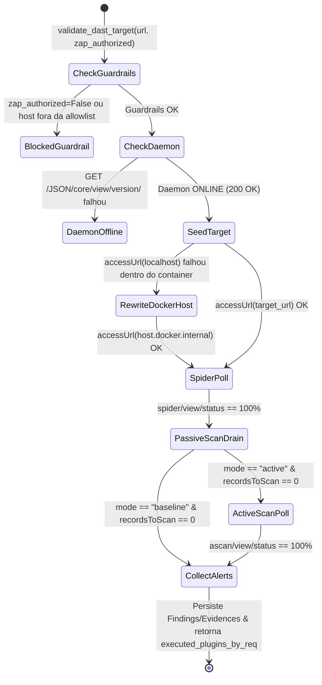

# Phase 1 Data Model: Integração Fim a Fim de Análise Dinâmica (DAST) (`002-zap-dast-integration`)

**Feature**: [spec.md](./spec.md)  
**Date**: 2026-10-13

---

## 1. Modelos de Domínio e Contratos DAST (Pydantic / ACI)

Esta feature preserva integralmente o esquema relacional SQLite (`asvs.db` em `app/models.py`: `Requirement`, `Run`, `Finding`, `Evidence`, `Verdict`, `ToolCall`, `AuditLog`) e adiciona estruturas tipadas para o diagnóstico de conectividade do daemon OWASP ZAP e para o ciclo sincronizado de varredura DAST.

### 1.1 `ZAPDaemonStatus` (Pydantic Schema — `GET /api/zap/status`)

| Campo | Tipo | Restrições / Regras de Validação | Descrição |
| :--- | :--- | :--- | :--- |
| `online` | `bool` | Obrigatório (`True` quando `/JSON/core/view/version/` responde `200 OK`) | Indica se o daemon OWASP ZAP está acessível em rede. |
| `version` | `str \| None` | Nullable (ex.: `"2.15.0"` quando `online == True`) | Versão reportada pelo daemon OWASP ZAP. |
| `zap_base_url` | `str` | Não-vazio (default `"http://localhost:8090"`) | URL base configurada para comunicação com a API REST do ZAP. |
| `allowed_hosts` | `list[str]` | Lista ordenada não-vazia (inclui `"localhost"`, `"127.0.0.1"`, `"host.docker.internal"`, `"vulnerable-app"`, `"web"`) | Hosts permitidos pelo guardrail de `allowlist` DAST. |
| `message` | `str` | Não-vazio | Mensagem diagnóstica pronta para exibição na interface (incluindo comando `docker compose up -d zap` quando `online == False`). |

---

### 1.2 Payload de Dados de `zap_spider` (`ACIResponse[dict]`)

| Campo | Tipo | Restrições / Regras de Validação | Descrição |
| :--- | :--- | :--- | :--- |
| `target_url` | `str` | URL original validada contra `allowlist` | URL alvo informada pelo usuário na `Run`. |
| `resolved_target_url` | `str` | URL efetivamente utilizada pelo daemon ZAP (`localhost` ou `host.docker.internal`) | URL alcançável a partir do container do OWASP ZAP. |
| `zap_daemon_used` | `bool` | `True` somente se o daemon ZAP respondeu à API REST | Confirma uso real do motor OWASP ZAP. |
| `spider_scan_id` | `str \| None` | ID retornado por `/JSON/spider/action/scan/` | Identificador da sessão de Spider no ZAP. |
| `spider_progress` | `int` | `0 <= spider_progress <= 100` | Percentual final atingido pelo polling de `/JSON/spider/view/status/`. |
| `urls_discovered` | `list[str]` | Truncado a `MAX_ACI_PAGE_SIZE = 50` | Lista de URLs descobertas na árvore HTTP do alvo. |
| `urls_count` | `int` | `>= 1` quando `zap_daemon_used == True` e o alvo respondeu a `accessUrl` | Total de URLs verificadas pelo Spider/semeadura. |

---

### 1.3 Payload de Dados de `zap_scan` (`ACIResponse[dict]`)

| Campo | Tipo | Restrições / Regras de Validação | Descrição |
| :--- | :--- | :--- | :--- |
| `target_url` | `str` | URL original informada na `Run` | URL alvo auditada. |
| `resolved_target_url` | `str` | URL resolvida para o container ZAP | Endereço efetivamente escaneado pelo ZAP. |
| `mode` | `Literal["baseline", "active"]` | `"baseline"` (default) ou `"active"` | Modo de varredura executado. |
| `zap_daemon_used` | `bool` | `True` somente se o daemon ZAP executou a varredura | Impede falsos positivos de cobertura quando o ZAP está offline. |
| `pscan_records_remaining` | `int` | `0` quando a fila passiva drenou completamente | Registros restantes em `/JSON/pscan/view/recordsToScan/`. |
| `ascan_progress` | `int \| None` | `100` quando `mode == "active"`, `None` quando `mode == "baseline"` | Percentual final do Active Scan (`/JSON/ascan/view/status/`). |
| `urls_tested` | `int` | `>= 1` quando o alvo foi inspecionado pelo ZAP | Contagem de URLs verificadas dinamicamente. |
| `executed_plugins_by_req` | `dict[str, list[str]]` | Mapeia cada `req_id` aos IDs de plugins ZAP efetivamente executados no modo | Alimenta `RequirementVerdictInput.zap_plugins_executed`. |
| `alerts_persisted` | `int` | `>= 0` | Total de alertas ZAP convertidos em `Finding` + `Evidence`. |

---

## 2. Transições de Estado do Ciclo DAST Sincronizado

