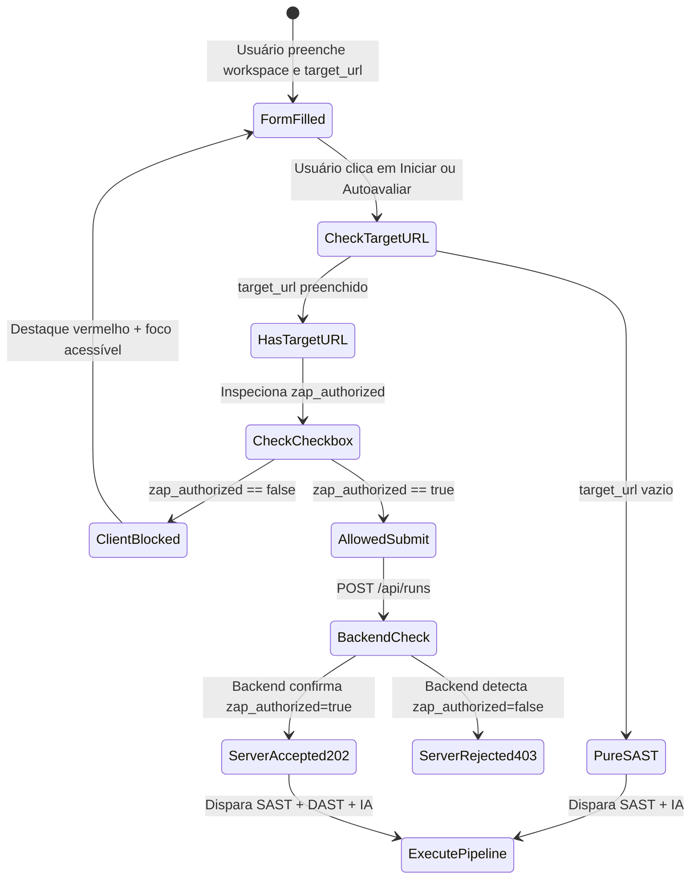

# Phase 1 Data Model: Avaliador com IA, Credenciais Write-Only e Guardrail DAST (`003-ai-evaluator-and-dast-guardrails`)

**Feature**: [spec.md](./spec.md)  
**Date**: 2026-10-13

---

## 1. Modelos de Domínio e Contratos Pydantic

Esta feature adiciona estruturas tipadas para o gerenciamento de credenciais de inteligência artificial em memória, contratos de teste de conectividade e o payload de avaliação do novo `AIEvaluatorAgent`, preservando o esquema relacional SQLite (`asvs.db` em `app/models.py`).

### 1.1 `AIConfigStatus` (Pydantic Schema — `GET /api/ai/status`)

| Campo | Tipo | Restrições / Regras de Validação | Descrição |
| :--- | :--- | :--- | :--- |
| `configured` | `bool` | Obrigatório (`True` quando há chave e modelo válidos em memória ou env) | Indica se o motor de IA está pronto para avaliações. |
| `model_name` | `str \| None` | Nullable, max 128 chars | Identificador do modelo de IA ativo (ex.: `"gemini-2.0-flash"`). |
| `key_masked` | `str \| None` | Nullable, sempre `"••••••••"` quando `configured == True`, nunca o valor real | Representação segura da presença da chave de API. |
| `provider` | `str` | Default `"gemini"` | Nome do provedor suportado. |

---

### 1.2 `AIConfigRequest` (Pydantic Schema — `POST /api/ai/config`)

| Campo | Tipo | Restrições / Regras de Validação | Descrição |
| :--- | :--- | :--- | :--- |
| `model_name` | `str` | Obrigatório, `1 <= len <= 128`, trim automático | Nome do modelo a ser utilizado (ex.: `"gemini-1.5-pro"`). |
| `api_key` | `str` | Obrigatório, `4 <= len <= 512`, Write-Only | Chave secreta de API. Jamais refletida em logs ou responses. |

---

### 1.3 `AITestConnectionResponse` (Pydantic Schema — `POST /api/ai/test-connection`)

| Campo | Tipo | Restrições / Regras de Validação | Descrição |
| :--- | :--- | :--- | :--- |
| `ok` | `bool` | `True` se o handshake respondeu com sucesso | Indica sucesso ou falha na comunicação com o modelo. |
| `model_name` | `str` | Não-vazio | Nome do modelo que respondeu ao teste. |
| `latency_ms` | `int` | `>= 0` | Tempo total de ida e volta do teste em milissegundos. |
| `message` | `str` | Mensagem descritiva sem chave de API | Resumo amigável pronto para exibição na UI. |

---

### 1.4 `AIEvaluatorInput` & `AIEvaluatorOutput` (Contratos do Agente)

```python
class AIEvaluatorInput(BaseModel):
    run_id: int
    req_id: str = "V1.3.1"
    source_path: str

class AIEvaluatorOutput(BaseModel):
    run_id: int
    req_id: str
    verdict: Literal["PASS", "FAIL", "INCONCLUSIVE", "MANUAL_REQUIRED"]
    confidence: Literal["HIGH", "MEDIUM", "LOW"]
    rationale: str
    model_used: str | None = None
    evidence_snippets: list[str] = Field(default_factory=list)
```

---

## 2. Matriz de Vereditos e Evolução de Cobertura (Alvo Seguro `app/`)

| Requisito (`req_id`) | Ferramentas Requeridas | Somente SAST | SAST + ZAP `baseline` | SAST + ZAP `active` | SAST + ZAP `active` + `AIEvaluatorAgent` |
| :--- | :---: | :---: | :---: | :---: | :---: |
| **V1.2.1** | `["semgrep", "zap"]` | `INCONCLUSIVE` | `PASS` | `PASS` | `PASS` |
| **V1.2.2** | `["semgrep", "zap"]` | `INCONCLUSIVE` | `PASS` | `PASS` | `PASS` |
| **V1.2.3** | `["semgrep", "zap"]` | `INCONCLUSIVE` | `PASS` | `PASS` | `PASS` |
| **V1.2.4** | `["semgrep", "zap"]` | `INCONCLUSIVE` | `INCONCLUSIVE` | `PASS` | `PASS` |
| **V1.2.5** | `["semgrep", "zap"]` | `INCONCLUSIVE` | `INCONCLUSIVE` | `PASS` | `PASS` |
| **V1.3.1** | `["semgrep", "ai_evaluator"]` | `MANUAL_REQUIRED` | `MANUAL_REQUIRED` | `MANUAL_REQUIRED` | **`PASS`** (IA validou autoescape Jinja2 e ausência de HTML rico) |
| **V1.3.2** | `["semgrep"]` | `PASS` | `PASS` | `PASS` | `PASS` |
| **V1.5.1** | `["semgrep", "zap"]` | `INCONCLUSIVE` | `INCONCLUSIVE` | `PASS` | `PASS` |
| **Métrica `% PASS`** | — | **`12.5%`** (1/8) | **`50.0%`** (4/8) | **`87.5%`** (7/8) | **`100.0% PASS`** (8/8) |

---

## 3. Diagrama de Estados da Submissão e Guardrail DAST



