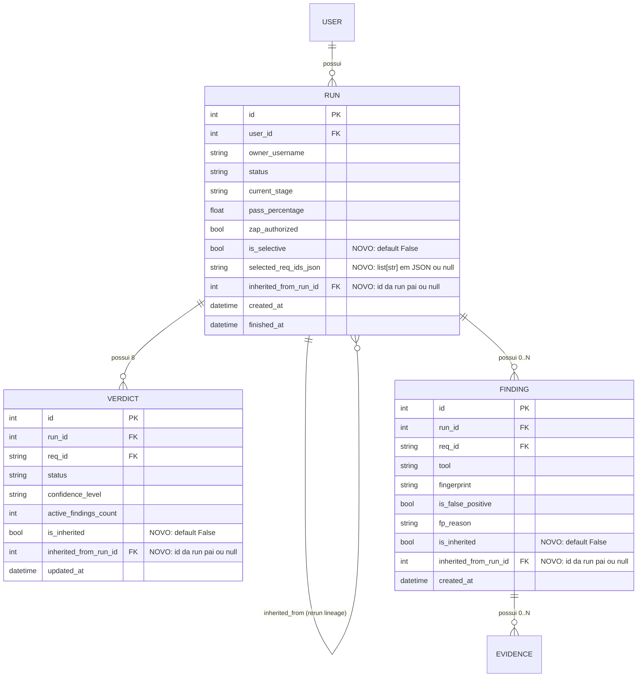

# Data Model: 008-selective-run-reexecution

**Feature**: `008-selective-run-reexecution`  
**Purpose**: Modelagem de entidades, esquemas Pydantic e linhagem de herança para reexecuções seletivas.

---

## 1. Diagrama Entidade-Relacionamento



---

## 2. Contratos Pydantic

### 2.1 `SelectiveRerunRequest`

```python
class SelectiveRerunRequest(BaseModel):
    """Payload opcional para POST /api/runs/{run_id}/rerun."""

    req_ids: list[str] | None = Field(
        default=None,
        description="Lista de IDs normativos ASVS V1 L1 para reexecução seletiva. Se omitido ou null, reexecuta todos os 8 requisitos.",
    )
```

Validações:
- Se fornecido, a lista não pode ser vazia (`len(cleaned) > 0`).
- Todos os identificadores devem pertencer a `IN_SCOPE_REQ_IDS` (`["V1.2.1", "V1.2.2", "V1.2.3", "V1.2.4", "V1.2.5", "V1.3.1", "V1.3.2", "V1.5.1"]`).
- Requisitos duplicados são deduplicados automaticamente.
- Requisitos inválidos disparam erro `400 Bad Request`.

---

## 3. Matriz de Mapeamento de Ferramentas por Requisito V1 L1

| ID Requisito | Seção | Ferramentas Mapeadas | Estágios Necessários |
| :--- | :--- | :--- | :--- |
| `V1.2.1` | Sanitização & Codificação | Semgrep + OWASP ZAP (Baseline) | SAST, DAST |
| `V1.2.2` | Sanitização & Codificação | Semgrep + OWASP ZAP (Baseline) | SAST, DAST |
| `V1.2.3` | Sanitização & Codificação | Semgrep + OWASP ZAP (Baseline) | SAST, DAST |
| `V1.2.4` | Sanitização & Codificação | Semgrep + OWASP ZAP (Active) | SAST, DAST |
| `V1.2.5` | Sanitização & Codificação | Semgrep + OWASP ZAP (Active) | SAST, DAST |
| `V1.3.1` | Manipulação Segura de Código | AI Evaluator (AIEvaluatorAgent) | AI_EVALUATION |
| `V1.3.2` | Manipulação Segura de Código | Semgrep | SAST |
| `V1.5.1` | Comunicação & Cookies | Semgrep + OWASP ZAP (Active) | SAST, DAST |

