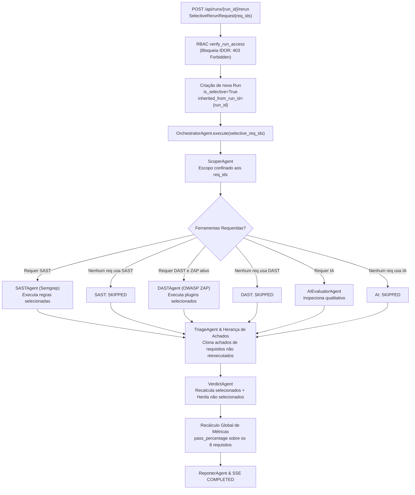

# Plan: 008-selective-run-reexecution

**Feature**: `008-selective-run-reexecution`  
**Title**: Reexecução Seletiva de Avaliações ASVS com Filtros Multidimensionais  
**Branch**: `008-selective-run-reexecution`  
**Status**: Ready for Gate 2 Review  

---

## 1. Executive Summary & Architectural Goals

A Feature 008 implementa a reexecução granular e seletiva de avaliações prévias do OWASP ASVS 5.0 (Capítulo V1 Nível 1). Ao invés de forçar o reprocessamento integral de todos os testes, o analista pode filtrar e selecionar exatamente quais requisitos deseja reavaliar (por Seção, ID, Veredito atual, Confiança e Ferramenta associada).

### Objetivos Arquiteturais:
1. **Otimização de Recursos**: Pular estágios desnecessários (ex.: se nenhum requisito selecionado exigir DAST ou IA, os estágios correspondentes são marcados como `SKIPPED`).
2. **Herança Auditável e Linhagem**: Para os requisitos não selecionados, seus vereditos, achados e evidências são clonados da avaliação base com a flag `is_inherited = True` e `inherited_from_run_id`, preservando a rastreabilidade.
3. **Consolidação Global**: A nova execução mantém uma visão completa de conformidade sobre todos os 8 requisitos normativos, recalculando o percentual global de aprovação (`pass_percentage`).
4. **Governança RBAC**: Apenas o proprietário da avaliação (ou administradores) podem disparar reexecuções parciais.
5. **Interface Fluent 2 Acessível**: Modal com filtros multidimensionais, suporte completo a navegação por teclado e conformidade estrita com a política de **Zero innerHTML**.

---

## 2. Technical Stack & Dependencies

- **Linguagem**: Python 3.12 / 3.13
- **Framework Web**: FastAPI (REST + SSE)
- **Persistência**: SQLModel, SQLAlchemy, SQLite (`asvs.db`)
- **Validação de Dados**: Pydantic v2
- **Interface**: HTML5, Jinja2, Microsoft Fluent 2 Web Components

---

## 3. Implementation Phases & Architecture Flow

---

## 4. Work Breakdown Structure

1. **Fase 1: TDD & Contratos de Teste (Blocker)**:
   - Criar `tests/test_selective_rerun.py` cobrindo cenários Given/When/Then da especificação:
     - Reexecução seletiva de 1 requisito de IA (`V1.3.1`): pula SAST e DAST, herda outros 7 vereditos.
     - Reexecução seletiva de 1 requisito de SAST (`V1.3.2`): pula DAST e IA, herda outros 7 vereditos.
     - Rejeição de `req_ids` inválidos ou fora do escopo V1 L1 (`HTTP 400`).
     - Rejeição de `req_ids` vazio (`HTTP 400`).
     - Proteção RBAC contra IDOR (`HTTP 403`).
2. **Fase 2: Modelagem de Dados & Migração**:
   - Atualizar `app/models.py` com `is_selective`, `selected_req_ids_json` e `inherited_from_run_id` em `Run`, `Verdict` e `Finding`.
   - Adicionar contrato `SelectiveRerunRequest` com validador estrito.
   - Atualizar migração idempotente em `app/database.py`.
3. **Fase 3: Orquestração e Lógica de Herança no Backend**:
   - Atualizar `OrchestratorInput` em `app/agents/orchestrator.py` com `selective_req_ids: list[str] | None`.
   - Implementar pulo condicional dos estágios SAST, DAST e IA.
   - Implementar clonagem de vereditos, achados e evidências para requisitos não selecionados.
   - Atualizar endpoint `POST /api/runs/{run_id}/rerun` em `app/main.py`.
4. **Fase 4: Frontend Fluent 2 & Filtros Multidimensionais**:
   - Criar botão "Reexecução Seletiva..." no Dashboard e Histórico.
   - Criar modal `<dialog id="selective-rerun-dialog">` em `templates/index.html`.
   - Implementar lógica de filtragem multidimensional por Seção, ID, Veredito, Confiança e Ferramenta em `static/app.js`.
   - Respeitar 100% a política de Zero innerHTML.
5. **Fase 5: Homologação, Revisões e Liberação de Gates**:
   - Rodar suíte completa de testes (`.venv/bin/pytest -q`).
   - Auditorias com `aci-security-reviewer` e `llm-security-reviewer`.
   - Parecer formal do `constitution-guardian` (Gate 3).

