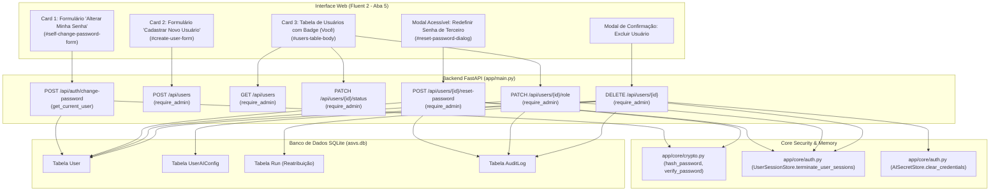

# Plano Técnico de Implementação (SDD Plan) — Feature 021: Gestão Completa de Usuários na Aba 5 (Admin)

**Branch**: `021-complete-user-management`  
**Created**: 2026-10-22  
**Status**: Ready for Implementation  
**Base**: OWASP ASVS 5.0 V1 L1 + Princípios Constitucionais I a VI  

---

## 1. Arquitetura e Estrutura Técnica

A Feature 021 complementa o módulo de autenticação e RBAC (introduzido na Feature 007) fornecendo controle total do ciclo de vida de contas de usuários na Aba 5 da aplicação web, sem comprometer a integridade auditável do sistema nem permitir lockouts acidentais.

### 1.1 Diagrama de Componentes e Fluxo de Execução



---

## 2. Modelagem de Dados e Contratos Pydantic (`app/models.py`)

### 2.1 Novos Schemas de Requisição:
1. **`UserResetPasswordRequest`**:
   ```python
   class UserResetPasswordRequest(BaseModel):
       """Payload for POST /api/users/{user_id}/reset-password (Admin only)."""

       new_password: str = PydanticField(..., min_length=8, max_length=128)
   ```
2. **`UserRoleUpdateRequest`**:
   ```python
   class UserRoleUpdateRequest(BaseModel):
       """Payload for PATCH /api/users/{user_id}/role (Admin only)."""

       role: Literal["admin", "user"]
   ```

### 2.2 Reuso de Contratos Existentes:
- `ChangePasswordRequest`: mantido para a rota de alteração de senha do próprio usuário logado (`current_password` + `new_password`).
- `UserResponse`: utilizado para retorno das operações de criação, status, role e reset de senha, omitindo terminantemente qualquer hash ou segredo.

---

## 3. Especificação dos Endpoints REST (`app/main.py`)

### 3.1 `POST /api/users/{user_id}/reset-password`
- **Autorização**: `require_admin`.
- **Validações**:
  - Usuário alvo deve existir no banco (HTTP 404 se não encontrado).
  - Alvo não pode ser a própria conta autenticada: `if target_user.id == admin.id` -> HTTP 400 ("Operação inválida: para alterar sua própria senha, utilize a opção 'Alterar Minha Senha'.").
- **Ações**:
  - `target_user.password_hash = hash_password(payload.new_password)`
  - `target_user.must_change_password = True` (obrigatório)
  - `target_user.updated_at = utcnow()`
  - `user_session_store.terminate_user_sessions(target_user.id)` (invalidação instantânea de sessões em memória)
  - Registro no `AuditLog` (ação `user_reset_password`)
- **Retorno**: `UserResponse` (HTTP 200).

### 3.2 `PATCH /api/users/{user_id}/role`
- **Autorização**: `require_admin`.
- **Validações**:
  - Usuário alvo deve existir no banco (HTTP 404).
  - Alvo não pode ser a própria conta autenticada: `if target_user.id == admin.id` -> HTTP 400 ("Operação bloqueada: não é permitido alterar o papel da sua própria conta.").
  - Prevenção de Lockout: se `target_user.role == "admin"` e `payload.role == "user"`, verificar se `active_admins <= 1` -> HTTP 400 ("Operação bloqueada: não é permitido revogar privilégios do último administrador ativo.").
- **Ações**:
  - `target_user.role = payload.role`
  - `target_user.updated_at = utcnow()`
  - `user_session_store.terminate_user_sessions(target_user.id)` (para forçar atualização das claims RBAC)
  - Registro no `AuditLog` (ação `user_role_update`)
- **Retorno**: `UserResponse` (HTTP 200).

### 3.3 `DELETE /api/users/{user_id}`
- **Autorização**: `require_admin`.
- **Validações**:
  - Usuário alvo deve existir no banco (HTTP 404).
  - Alvo não pode ser a própria conta: `if target_user.id == admin.id` -> HTTP 400 ("Operação bloqueada: não é permitido excluir a própria conta logada.").
  - Prevenção de Lockout: se `target_user.role == "admin"`, verificar se `active_admins <= 1` -> HTTP 400 ("Operação bloqueada: não é permitido excluir o último administrador ativo.").
- **Ações Atômicas (Mesma Transação)**:
  1. Remover registro órfão em `UserAIConfig` associado ao usuário, se existir.
  2. Preservar integridade do histórico ASVS: reassociar execuções de avaliação (`Run`) para `admin.id`.
  3. Desassociar entradas em `AuditLog` vinculadas ao usuário (`user_id = None`).
  4. Remover o usuário da tabela `User`: `session.delete(target_user)`.
  5. `session.commit()`
  6. Revogação de sessões e credenciais de IA em memória: `user_session_store.terminate_user_sessions(target_user.id)`.
  7. Registro de auditoria do evento `user_delete`.
- **Retorno**: `{"message": "Usuário excluído com sucesso.", "id": user_id}` (HTTP 200).

---

## 4. Frontend e Experiência do Usuário (Fluent 2)

### 4.1 Modificações em `templates/index.html`:
1. **Card "Minha Conta / Alterar Minha Senha"** adicionado logo no início da seção `#panel-users`:
   - Campos: Senha Atual (`#self-current-password`), Nova Senha (`#self-new-password`), Confirmar Nova Senha (`#self-confirm-password`).
   - Botão "Salvar Nova Senha" (`#btn-self-change-password`).
   - Banner de feedback acessível (`#self-password-feedback`, com `role="status"`).
2. **Coluna de Ações na Tabela de Usuários Cadastrados**:
   - Botão "Desativar / Ativar".
   - Seletor de Papel ou Ação de Mudança de Papel.
   - Botão "Redefinir Senha" com ícone/texto claro.
   - Botão "Excluir" com estilo de perigo.
3. **Diálogo Acessível `<dialog id="reset-user-dialog">`**:
   - Modal com campos para digitar a nova senha temporária para o usuário selecionado.
   - Botões "Confirmar Redefinição" e "Cancelar".

### 4.2 Modificações em `static/app.js`:
1. **Handler para `#self-change-password-form`**:
   - Valida confirmação de senha localmente.
   - Dispara `POST /api/auth/change-password` enviando `current_password` e `new_password`.
   - Exibe feedback em verde/vermelho sem recarregar a tela e limpa os campos em caso de sucesso.
2. **Atualização da função `loadUsersList()`**:
   - Renderização segura via `el()` / `textContent` (Zero XSS / Zero `innerHTML`).
   - Identificação do usuário logado: adiciona badge `(Você)` no nome de usuário.
   - Se a linha corresponder ao usuário logado:
     - Botão de status: desabilitado com tooltip explicativo.
     - Botão/seletor de role: desabilitado com tooltip explicativo.
     - Botão de exclusão: desabilitado com tooltip explicativo.
     - Botão de redefinição: desabilitado com orientação para usar o card do topo.
   - Se a linha for de outro usuário:
     - Botão Ativar/Desativar: aciona `PATCH /api/users/{id}/status`.
     - Alteração de Role: dispara `PATCH /api/users/{id}/role` com confirmação.
     - Redefinição de Senha: abre o modal de redefinição e dispara `POST /api/users/{id}/reset-password`.
     - Exclusão: abre confirmação nativa/acessível e dispara `DELETE /api/users/{id}`.
3. **Versão de UI Atualizada**:
   - Constante `APP_UI_VERSION = "021"`.
   - Links de assets atualizados para `?v=021`.

---

## 5. Estratégia de Testes Automatizados (TDD)

Criar o arquivo de testes `tests/test_feature_021_user_management.py` cobrindo rigorosamente:
1. `test_self_change_password_success_and_failure()`: Troca da própria senha com senha atual válida e inválida.
2. `test_admin_reset_user_password()`: Admin define senha temporária de outro usuário, com `must_change_password=True` e invalidação de sessão.
3. `test_admin_cannot_reset_own_password_via_reset_endpoint()`: Bloqueio de auto-reset sem senha atual.
4. `test_admin_change_user_role()`: Promoção de `user` a `admin` e rebaixamento de `admin` a `user`.
5. `test_cannot_demote_self_or_last_admin()`: Bloqueio de auto-rebaixamento e bloqueio de rebaixamento do último admin ativo.
6. `test_admin_delete_user_success()`: Exclusão com cascata em `UserAIConfig` e reatribuição de histórico.
7. `test_cannot_delete_self_or_last_admin()`: Bloqueio de auto-exclusão e bloqueio de exclusão do último admin ativo.
8. `test_non_admin_forbidden_on_all_new_endpoints()`: Usuário sem papel `admin` recebe HTTP 403 em todos os endpoints de gestão.
9. `test_ui_assets_contain_feature_021_elements()`: Validação estática de `index.html` e `app.js` assegurando existência dos componentes e conformidade DOM segura.

