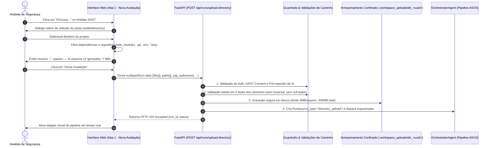

# Plano Técnico (SDD Plan) — Feature 022: Seleção de Diretório Local do Código-Fonte

**Branch**: `022-local-directory-picker`  
**Created**: 2026-10-24  
**Status**: Ready for Implementation (Revisado com Recomendações de Threat Modeler e Constitution Guardian)  
**Base**: OWASP ASVS 5.0 V1 L1 + Princípios Constitucionais I a VI  

---

## 1. Arquitetura e Fluxo de Execução



---

## 2. Especificação do Backend

### 2.1 Módulo de Segurança de Arquivos (`app/aci/workspace_aci.py`)

Adicionar a função utilitária `save_safe_directory_upload`:
```python
MAX_DIR_UPLOAD_FILE_BYTES = 5 * 1024 * 1024  # 5 MB por arquivo individual
MAX_DIR_TOTAL_BYTES = 300 * 1024 * 1024       # 300 MB limite agregado
MAX_DIR_FILES = 15000                         # 15.000 arquivos máximos

def save_safe_directory_upload(
    upload_files: list[UploadFile],
    relative_paths: list[str],
    upload_id: str,
    base_root: Path | None = None,
) -> Path:
    """Save streamed files from directory upload into a safe, confined folder."""
```

#### Regras de Higienização e Guardrails (Fase 1 - Validação Pura):
1. **Identificador Seguro**: `upload_id` validado por regex `^[a-zA-Z0-9_-]+$`.
2. **Diretório de Destino**: `target_dir = (base_root or WORKSPACE_ROOT) / ".workspace_uploads" / f"dir_{upload_id}"`. Criado com `mkdir(parents=True, exist_ok=False)`.
3. **Paridade de Listas**: `len(upload_files) == len(relative_paths)` e `1 <= len(upload_files) <= MAX_DIR_FILES`.
4. **Higienização de Caminhos Relativos**:
   - Rejeição imediata se contiver byte nulo `\x00` ou caracteres de controle ASCII `0x01` a `0x1F`.
   - Normalização de barras invertidas (`\\` → `/`).
   - Normalização Unicode para NFC (`unicodedata.normalize('NFC', p)`).
   - Rejeição de caminhos que comecem com `/` ou letra de unidade Windows (`^[A-Za-z]:`).
   - Rejeição de qualquer segmento vazio (`//`), segmento de ponto único (`./`) ou segmento de escape (`..`).
   - Rejeição de dispositivos reservados do Windows (`CON`, `PRN`, `AUX`, `NUL`, `COM1-9`, `LPT1-9`) em qualquer segmento.
   - Rejeição de arquivos com caracteres de Alternate Data Stream (`:`).
   - Verificação de confinamento rigoroso com `resolve().is_relative_to(target_dir.resolve())`.
   - Detecção antecipada de duplicatas e de conflitos arquivo-diretório (ex.: `src/app` e `src/app/main.py`).

#### Regras de Gravação em Disco (Fase 2 - Streaming Confinado):
- A gravação ocorre em blocos de 64 KB a partir do `UploadFile.file`.
- Verificação do teto de 5 MB por arquivo e 300 MB agregados.
- Criação dos nós com `os.open(file_path, os.O_WRONLY | os.O_CREAT | os.O_EXCL | getattr(os, "O_NOFOLLOW", 0), 0o600)` para impedir seguir symlinks preexistentes.
- Em qualquer exceção ou cancelamento (`BaseException`), execução imediata de rollback atômico com `shutil.rmtree(target_dir, ignore_errors=True)`.

### 2.2 Endpoint REST em `app/main.py`

Implementar `@app.post("/api/runs/upload-directory", status_code=status.HTTP_202_ACCEPTED)`:
1. **Pre-flight Checks**:
   - `current_user`: autenticação obrigatória via `get_current_user` (HTTP 401).
   - `zap_authorized`: validação booleana estrita (HTTP 403 se ausente/falso).
   - `AI Secret Gate`: verificação de configuração de IA ativa em sessão ou banco (HTTP 412 se não configurado).
   - `validate_dast_target`: validação de URL alvo contra allowlist de hosts e esquemas seguros (HTTP 403 se inválida).
2. **Processamento do Multipart**:
   - Extração assíncrona das listas `files` e `paths`.
   - Verificação de campos presentes e não-vazios.
   - Invocação de `save_safe_directory_upload` executada via threadpool para não bloquear o event loop assíncrono.
3. **Criação da Execução e Despacho**:
   - Persistência do registro `Run(source_type="directory_upload", source_path=str(extracted_dir), ...)`.
   - Disparo do `OrchestratorAgent.execute` em background (ou síncrono se `sync=True`).
   - Retorno JSON semântico `HTTP 202 Accepted` com `run_id` e metadados.

---

## 3. Especificação do Frontend

### 3.1 Alterações em `templates/index.html`:
- Atualização do seletor de origem no Card SAST:
  ```html
  <select id="source-type" name="source_type" class="fluent-select">
    <option value="directory_upload" selected>Caminho em Diretório Local</option>
    <option value="zip_upload">Upload de Arquivo .ZIP</option>
  </select>
  ```
- Remoção visual do campo de texto livre `#workspace-subpath`.
- Adição do grupo de seleção de diretório:
  ```html
  <div class="form-field" id="directory-upload-group">
    <label for="source-directory">Diretório do Código-Fonte</label>
    <input
      type="file"
      id="source-directory"
      name="source_directory"
      class="fluent-input"
      webkitdirectory
      directory
      multiple
    >
    <div id="source-directory-summary" role="status" aria-live="polite" style="display:none; margin-top:6px; font-size:13px; color:var(--colorNeutralForeground2); padding:6px 10px; background:var(--colorNeutralBackground2); border:1px solid var(--colorNeutralStroke1); border-radius:var(--borderRadiusMedium);"></div>
    <small style="color:var(--colorNeutralForeground3);">
      Clique em "Procurar..." para selecionar a pasta raiz do projeto no disco local. Dependências (node_modules, .git, .venv) são ignoradas automaticamente.
    </small>
  </div>
  ```
- Atualização de versão de cache-busting nos assets para `?v=022`.

### 3.2 Lógica em `static/app.js`:
- Função `syncSastSourceFields()`: alterna visibilidade entre `#directory-upload-group` e `#zip-upload-group`.
- Função `filterAndCollectDirectoryFiles(fileList)`:
  - Ignora pastas de dependências (`node_modules`, `.git`, `.venv`, `venv`, `__pycache__`, `.idea`, `.vscode`, `dist`, `build`).
  - Ignora arquivos de segredos órfãos (`.env`, `*.key`, `*.pem`, `id_rsa`).
  - Ignora arquivos individuais que excedam 5 MB.
  - Computa contagem de arquivos aceitos, contagem de ignorados e tamanho total em bytes.
- Event listener `change` em `#source-directory`:
  - Renderiza resumo seguro via `textContent` no container `#source-directory-summary` com ícone `<span aria-hidden="true">📁</span>`.
  - Exibe feedback imediato se a pasta for inválida ou não contiver arquivos elegíveis.
- Submissão do Formulário de Avaliação:
  - Se `sourceType === "directory_upload"`:
    - Valida se há arquivos selecionados.
    - Constrói `FormData` anexando cada arquivo com chave `files` e seu caminho relativo normalizado com chave `paths`.
    - Envia requisição para `/api/runs/upload-directory`.
- Atualização da constante `APP_UI_VERSION = "022"`.

---

## 4. Matriz de Testes Automatizados (TDD)

Arquivo: `tests/test_feature_022_directory_upload.py`

1. `test_save_safe_directory_upload_success`: Gravação em árvore preservando pastas relativas (`src/a.py`, `src/utils/b.py`).
2. `test_save_safe_directory_upload_blocks_path_traversal`: Bloqueio estrito de `../malicious.py`.
3. `test_save_safe_directory_upload_blocks_absolute_and_drive_paths`: Bloqueio de `/etc/passwd` e `C:\app\x.py`.
4. `test_save_safe_directory_upload_blocks_null_bytes_and_special_devices`: Bloqueio de `foo\x00bar.py` e `CON.py`.
5. `test_save_safe_directory_upload_blocks_file_dir_conflict`: Bloqueio ao tentar gravar `app` como arquivo e `app/main.py`.
6. `test_save_safe_directory_upload_enforces_size_limits`: Rejeição de arquivo individual > 5 MB e total > 300 MB.
7. `test_save_safe_directory_upload_cleans_up_on_failure`: Validação de rollback completo com `shutil.rmtree` em caso de erro no meio do processo.
8. `test_endpoint_upload_directory_success`: Chamada com TestClient gerando Run com `source_type="directory_upload"`.
9. `test_endpoint_upload_directory_requires_auth`: Retorno HTTP 401 para requisição anônima.
10. `test_endpoint_upload_directory_requires_dast_consent`: Retorno HTTP 403 se `zap_authorized=False`.
11. `test_endpoint_upload_directory_requires_ai_configured`: Retorno HTTP 412 se IA não estiver configurada.
12. `test_endpoint_upload_directory_validates_list_parity`: Retorno HTTP 400 se número de `files` for diferente de `paths`.
13. `test_ui_assets_contain_directory_picker_and_no_workspace_label`: Verificação estática do template e scripts confirmando presença de `webkitdirectory`, "Caminho em Diretório Local", ausência de "Caminho em Workspace Local" e versão `022`.
